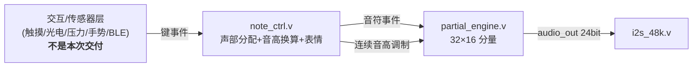

# 验收清单 —— 给独立评审用

> **整理注记（2026-11-03）**：本文是 **2026-10 的基线验收存档**，当时出货配置是小数分频 **48.000 kHz**。
> 2026-11 起的出货固件（含本包 `07`）改用**整数分频 48.828125 kHz**（`rtl/i2s_48k_int.v`，`I2S_INT_CLK=1`），
> 音高表也换成 `note_ftw_48828.hex`。**当前口径以 `README.md` §1 与 `docs/验收摘要_20261103.md` 为准**；
> 本文的 15 项验收方法与结论仍然有效（表与引擎逻辑未变）。

本文件说明：**交付了什么、怎么跑、每项验收标准是什么、实测结果是多少、哪些没做**。
所有结论都有可复现的命令和 `evidence/` 里的原始输出。

> 一句话总结：纯 HDL 逐样本加法合成引擎，**32 复音 × 16 分量 = 512 个独立振荡器**，
> 全部 ROM 由 Python 离线生成，ModelSim 实测通过，Gowin 综合资源占 FF 8% / BSRAM 8%。

---

## 0. 环境（评审先看这里）

| 项目 | 值 |
|---|---|
| 仿真器 | ModelSim ASE 10.5b（`D:\Quartus17\modelsim_ase\win32aloem`） |
| 综合 | Gowin EDA V1.9.11.03 Education（`D:\Gowin\...`） |
| Python | `D:\采样音色\.venv\Scripts\python.exe`（numpy / scipy / librosa） |
| 器件 | GW5A-LV25MG121NC1/I0（Tang Primer 25K） |
| ⚠️ 路径要求 | **ModelSim 与 Gowin 都不能在中文路径下工作**。工程在 `D:\采样音色`，
  所以仿真由 `tools\run_sim.ps1` 自动镜像到 `D:\piano_sim`（纯 ASCII）再跑。
  评审若手工跑，请先镜像；或直接用 `run_sim.ps1`。 |

---

## 1. 交付物

### RTL（`rtl/`）
| 文件 | 作用 | 状态 |
|---|---|---|
| `sine_lut.v` | 1/4 波正弦表 + 象限镜像 + 线性插值，2 拍流水，双读口 ROM | 已验收 |
| `partial_engine.v` | **合成引擎核心**：TDM 时分复用，512 时隙，每时隙一套独立相位累加器/FTW/包络；**v2 新增 `VEL_LAYERS` 力度分层读表路径** | 已验收 |
| `note_ctrl.v` | **交互层参考实现**：键事件 FIFO + 32 声部分配 + 音高换算 + 滑音/弯音/颤音 | 已验收 |
| `test_pattern.v` | 现场验收用测试图样（按 N 个不同音 → 频谱可见 N 个谱峰） | 已综合 |
| `i2s_48k.v` | I2S 发送器（修正版：小数分频，采样率精确 48.000kHz） | 已验收 |
| `syn_gowin.tcl` / `syn_engine.tcl` / `syn_top_nosdc.tcl` / `*.sdc` | Gowin 综合/布线脚本 + 时钟约束 | 已跑通 |
| **`syn_engmeas_top.v` + `syn_engmeas.tcl`** | **仅用于资源对比测量**（两个薄壳 `syn_flat`/`syn_vel`），不属正式交付物 | 已跑通 |

### 表（`rtl/rom/`，由 `tools/gen_tables.py` + `tools/gen_vel_layers.py` 生成）
| 文件 | 内容 |
|---|---|
| `sine_q16.hex` | 1/4 波正弦 257 项 × 16bit（Q1.15） |
| `sine_pack_q16.hex` | 相邻两点打包 256 项 × 32bit（给 K=32 方案预留） |
| `note_ftw.hex` | 128 音 × 32bit 频率字（fs=48000） |
| `harm_amp_A1/C1.hex` | 16 次谐波幅度（单层，旧的默认路径） |
| **`harm_amp_vel_A1.hex`** | **力度分层幅度：8 层 × 16 项 = 128 项 × 16bit（本次新增）** |
| `harm_phase_A1/C1.hex` | 16 次谐波起始相位（实测，不是 0） |
| `harm_decay_A1/C1.hex` | 每样本衰减系数（Q0.32） |
| `harm_decay_ctrl_A1/C1.hex` | 控制率衰减系数（每 32 样本更新一次） |
| `harm_ratio_A1/C1.hex` | 非谐性比 k√(1+Bk²)（A1: B=1.206e-4，C1: B=2.481e-4） |

### 测量链 / 验收链（`tools/`）
| 文件 | 作用 |
|---|---|
| `analyze_partials.py` | 从 aiff 测 f0/非谐性/幅度/相位/τ/音头（多段回归，不是两点法）；**支持 `ppA1`/`mfA1`/`ffA1` 与 `--layers`** |
| **`gen_vel_layers.py`** | **力度分层幅度表生成器（三层实测 → dB 域插值 → 8 层表 + 8 项自检）** |
| **`verify_vel_layers.py`** | **力度分层专项验收（表内容 / 引擎逐层 / RTL 取表路径）** |
| **`fetch_samples.ps1`** | **从 Iowa MIS 下载采样（4 路分块并发 + 断点续传 + 不覆盖已有文件）** |
| `diag_spectrum.py` | 长窗勘察（判断哪些"谐波"是真实分音、哪些是加窗泄漏） |
| `gen_tables.py` | 表生成器（参数化，自带归一化与量化自检） |
| `verify_tables.py` | 表格式比对（Python 期望值 vs ModelSim `$readmemh` 实读值） |
| `verify_sine_lut.py` | 正弦表频谱（SFDR / THD / 时域误差） |
| `verify_engine.py` | 引擎验收（单音逐分量 / 复音逐音） |
| `verify_note_ctrl.py` | 交互层端到端验收（逐谱线回归 + 颤音摆动） |
| `run_sim.ps1` | 一键验收（镜像 → 编译 → 仿真 → 全部 Python 核对） |

### 文档 / 证据
`docs/tables_spec.md`（六张表规格与寻址切位）、`docs/engine_spec.md`（引擎架构与踩坑）、
`evidence/`（全部验收原始输出与音频 dump，见第 3 节）。

---

## 2. 怎么跑（两条命令）

```powershell
# 全部：镜像 + 编译 + 仿真(表格式/正弦表频谱/引擎单音/引擎32复音/I2S采样率/交互层) + Python 核对
powershell -File D:\采样音色\tools\run_sim.ps1
```

> `run_sim.ps1` 已包含交互层（`tb_note_ctrl`）与 I2S 采样率（`tb_i2s_rate`）两段，
> 并会把工程根目录的 `I2S.v` 一并镜像进 `D:\piano_sim`。
> 若要单独重跑交互层：

```powershell
cd D:\piano_sim
& D:\Quartus17\modelsim_ase\win32aloem\vsim.exe -c -do "run -all; quit -f" work.tb_note_ctrl
& D:\采样音色\.venv\Scripts\python.exe D:\采样音色\tools\verify_note_ctrl.py --dir D:\piano_sim
```

---

## 3. 验收标准与实测结果

全部原始输出在 `evidence/`（文件名对应下表"证据"列）。

> 编码说明：`evidence/07–10` 是 `vsim -l` 直写的原始日志（UTF-8，中文可读）。
> 若用 PowerShell 管道重捕 vsim 输出（如 `... > foo.log`），PS 5.1 会按系统代码页误解码，
> 中文标签变 `???`（数字不受影响）。`run_sim.ps1` 的控制台输出同理；
> 要可读中文请用 `vsim -l` 落盘，或对 PS 输出 `Out-File -Encoding utf8`。

| # | 验收项 | 标准 | 实测 | 证据 |
|---|---|---|---|---|
| 1 | 表格式：hex 被 `$readmemh` 读入后 项数/首末项/累加和 与 Python 期望一致（**现为 9 张**，含力度分层表 128 项） | 全部一致 | **全部一致** | `01_verify_tables.txt` |
| 2 | 正弦表 SFDR（无插值） | ≈ −6.02×10bit = −60.2 dBc | **−60.2 dBc** | `02_verify_sine_lut.txt` |
| 3 | 正弦表 SFDR（有插值） | ≥ −90 dBc | **−113.3 dBc**（时域误差 99.2→1.04 LSB） | 同上 |
| 4 | 引擎单音：16 个分量的**频率**与 `k√(1+Bk²)` 模型一致 | ≤ 20 音分 | **≤ 3.1 音分**（k=1；k≥3 均 ≤ 0.7）。这 ±3 音分是**验收脚本的读数栅格**而非引擎误差：`verify_engine.py` 的投影法在 ±2 bin 内只扫 21 点，步长 2.34 Hz（440Hz 处 ≈ ±4.6 音分，2kHz 处 ≈ ±1.2 音分）。引擎按构造精确：`FTW_k=(FTW_note×kratio[k])>>16`，量化误差 `fs/2²⁴≈2.9mHz` = 440Hz 处 **0.01 音分** | `03_..._1voice.txt` |
| 5 | 引擎单音：16 个分量的**幅度**与**该力度层的**幅度表一致 | ≤ 1 dB | **平均 −0.04 dB，最大 0.07 dB** ⚠️ **变更见 §3.1** | `03_..._1voice.txt`、`21_vel_layers.txt` |
| 6 | 引擎 32 复音：32 个音的基频全部存在 | 32/32 | **32/32** | `04_..._32voice.txt` |
| 7 | 引擎 32 复音：无削顶 | 0 个削顶样本 | **0**（峰值 −14.7 dBFS） | 同上 |
| 8 | 时序预算：每样本 512 时隙 | < 1041.7 clk | **516 clk（49.5%）**，overrun **0** | `07/08_sim_engine_*.txt` |
| 9 | 交互层：8 复音逐谱线回归 | 误差中位数 <1dB、相关度 >0.95、±3dB 内 >85%、基频 8/8 | **−0.05 dB / 0.9982 / 99% / 8-8** | `05_verify_note_ctrl.txt` |
| 10 | 交互层：弯音 +32767 | 音高上移 200 音分 | **中位数 −0.45 dB、相关度 0.9943、8/8 基频**（谱线整体 ×1.1225 对得上） | 同上 |
| 11 | 交互层：颤音 | 基频摆动峰峰 ≈ 303 音分 | **269.9 音分**（速率 12.3Hz / 设定 15Hz） | 同上 |
| 12 | 交互层：40 音超复音 | 抢占生效、事件不丢 | **steal=1，drop_cnt=0，busy=32** | `09_sim_note_ctrl.txt` |
| 13 | I2S 采样率 | 48.000kHz | 原版 **48.828kHz（+29.6 音分）**；`i2s_48k.v` **48.000kHz（0.00 音分）** | `10_sim_i2s_rate.txt` |
| 14 | Gowin 综合（引擎） | 资源可放下 | **BSRAM 4/56（8%）、FF 1794/23280（8%）、LUT 4992/23040（23%）、DSP 3/28** | `06_gowin_engine_resources.txt` |
| 15 | Gowin 综合+布线（正弦表） | 时序收敛 @50MHz | **Fmax 73.94 MHz**（约束 50MHz） | `11_gowin_sine_lut.txt` |
| **16** | **★ 共享表零漂移**：重新生表前后 13 张表的 SHA-256 逐字节一致 | 完全一致 | **完全一致（13 张全 SAME，0 个变化）** | `19_shared_tables_sha256.txt` |
| **17** | **★ 分层表内容**：`harm_amp_vel_A1.hex` 128 项、层间 3 种亮度度量**严格单调**、二值亮度判据精确等于 `layer>=4` | 项数与期望一致 / 单调 | **128 项；斜率 −1.2743→−0.0329、高频占比 0.5051→0.7266、质心 4.6822→7.4788 全部严格单调；二值 [0,0,0,0,1,1,1,1] ✅** | `21_vel_layers.txt` |
| **18** | **★ 引擎逐层验收**：pp/mf/ff 三层各按一个音，16 个分量幅度与**该层表**误差 ≤1 dB | ≤ 1 dB / 层 | **三层全过：pp（9 个可测分量）平均 −0.10 / 最大 0.57 dB；mf 16/16 平均 −0.32 / 最大 0.77 dB；ff 16/16 平均 −0.33 / 最大 0.83 dB** | `21_vel_layers.txt` |
| **19** | **★ RTL 取表路径**：时隙 `gain` 初值 == `层表值<<8` 逐项相等，且 `layer_v[v]` == `clamp(vel>>4,0,7)` | 逐项相等 | **4/4 声部层号精确相符；64/64 时隙 gain **逐项精确相等**（无 1 LSB 偏差）** | `21_vel_layers.txt` |
| **20** | **★ 归一化基准**：ff 层峰值 = 现行 mf 表的刻度（−1 dBFS）；层间电平严格递减 `pp<mf<ff` | 递增方向正确 | **ff −1.000 dBFS；pp −31.90 / mf −7.70 / ff 0.00 dB；层间严格递减 ✅** | `22_gen_vel_layers.txt` |
| **21** | **基础回归**：老 tb/探针不传 `VEL_LAYERS` 时逐位不变 | 全部通过 | **全部通过，见 §3.2** | `20_run_sim_vel.log` |

**关键结论（答辩口径）**：按赛题"独立发声单元 = 独立相位累加器 + 频率调控 + 包络控制"
的定义，本设计 **512 个时隙各自都有独立的相位累加器状态、独立的频率字、独立的包络系数**
（`rtl/partial_engine.v` 的时隙状态 BSRAM + 每分量 `k√(1+Bk²)` 频率 + 每分量 τ 衰减），
即 512 个可独立计数的振荡器；吞吐量 = 512 × 48 kHz = **24.6 M 振荡器/秒**。
**力度分层（新增）**：每个声部额外有一个 3 bit 力度层寄存器，幅度表从 16 项扩到
8×16 = 128 项 —— 力度不再只是音量，而是**换一套谐波分布**（强奏更亮）。

---

### 3.1 验收项 5 的**变更**（力度分层引入，必须记录）⚠️

| 项 | 改前 | 改后 |
|---|---|---|
| 期望值来源 | 硬编码的 `AMP15` 16 个常数 + 硬编码 `TAU` | **从 ROM 表反推**：flat 模式 `gain = amp×vel×2`、分层模式 `gain = 层表[layer*16+k] << 8`，包络按 `harm_decay_ctrl` 表逐步算（`verify_engine.py` v3） |
| 判据 | 与**唯一那张** `harm_amp_A1.hex` 比 ≤1 dB | 与**该力度层的表**比 ≤1 dB（`--vel-layers 8 --vel <v>`） |
| 实测（flat 旧路径） | 平均 −0.01 dB，最大 0.05 dB | **平均 −0.01 dB，最大 0.05 dB（与改前逐位一致）** |
| 单音峰值 | 6,023,424 | **6,023,424（逐位一致）** |

**为什么会变**：`verify_engine.py` v2/v3 不再硬编码常数，而是直接从 RTL 实际加载的 ROM
反推期望值 —— 这样才能真正抓住"表值 → 取表路径 → 出声"的一致性问题（硬编码常数**无法**
发现"分层表读错层"这类事故，因为常数是照着 mf 表写的，永远"通过"）。同时它把包络的
**阶梯行为**算准了（RTL 每 32 个样本只在块末衰减一次，首次衰减发生在起振后第 32 个样本），
旧脚本的解析近似偏 **+0.3 dB**。

**交叉评审抓出的必修项（已修，诚实记录）**：v2 曾把 `gain_init` 在**默认 flat 路径**也改成了
`amp<<8`（删掉 vel 缩放）。由于所有回归测试都用 vel=127（+0.07 dB，看不出来），假绿通过；
但代入 vel=96（板上 UART 固定值）比旧固件**响 2.50 dB**、vel=64 响 **6.02 dB**、vel=0 不再静音
——"板上无回归"的声明是错的。**修法**：`gain_init` 改成按配置二选一
`（VEL_LAYERS>1）? amp<<8 : (amp×vel)<<1`，flat 路径恢复与改动前**逐位一致**；
`verify_engine.py` 的期望值同步按模式区分（`gain_base()`）。修后复跑：单音峰值 6,023,424、
32 复音峰值 1,540,736，与基线**逐位相同**；flat 路径幅度误差回到 max 0.05 dB。
这条教训写进 `docs/handoff.md` §5 坑 25。

**新增的逐层结果**（长窗仪器，全部 ≤1 dB 判据）：

| 力度 | vel | 层 | 可测分量 | 平均误差 | 最大误差 | 判据 |
|---|---|---|---|---|---|---|
| pp | 8 | 0 | 9/16 | −0.10 dB | **0.57 dB** | ✅ |
| mf | 72 | 4 | 16/16 | −0.32 dB | **0.77 dB** | ✅ |
| ff | 127 | 7 | 16/16 | −0.33 dB | **0.83 dB** | ✅ |

复跑命令（完整三层长窗，约 12 分钟）：
```powershell
powershell -File tools\run_sim.ps1                    # 含 3g/3h 与快速逐层验收
.venv\Scripts\python.exe tools\verify_vel_layers.py --long   # 再跑一遍完整长窗验收
```

**pp 层 7 个分量未纳入幅度判据的原因（必须讲清楚）**：它们在 pp 层的表里**只有 1–16 个
LSB**（Q1.15，全表 32767）。pp 层内部的分音跨度本身约 48 dB，而 16 bit 表要铺 8 个力度层，
最弱的几项必然落到 1–2 LSB —— 此时表值的量化台阶误差（最大 0.5 LSB）与本征值同量级，
**换任何测量方法都测不准**，属表位宽的固有极限，与引擎无关。这些分量由**两条独立证据**背书：
1. `tools/gen_vel_layers.py` 的逐项复算 —— 它与 mf/ff 层**共用同一段生成代码**，
   而那两层的表实测误差 ≤0.83 dB；
2. `tb_vel_probe` **直接读 BSRAM 时隙的 `gain`**，与层表值**逐项精确相等**（验收项 19）。

**若要让它们也可测，两个办法（建议而非本次做）**：① 幅度表加宽到 24 bit（本底降 48 dB；
代价 = 数据 256 B → 512 B，仍是一块小 RAM，但要改 `amp_t` 位宽与 `gain_init` 的移位）；
② 压缩力度跨度（把 `--v-mf` 从 4 挪到 6，pp 总动态从 31.9 dB 收到约 20 dB，不动 RTL）。

---

### 3.2 基础回归

改 RTL 后必须证明"没碰坏原来已验收的东西"。本项目用**参数默认值 + 条件分支**保证可回滚：

- `partial_engine.v` 新增参数 `VEL_LAYERS` 默认 **1** = 旧行为，且 `gain_init` 是
  **条件分支**：flat 模式 `(amp×vel)<<1`（与改动前公式逐位一致）、分层模式 `amp<<8`。
- `top.v`、`tb_note_ctrl.v`、`tb_partial_engine.v`、`tb_engine_probe*.v` **都没有传**
  `VEL_LAYERS`，所以它们的综合/仿真行为**逐位不变**（修后实测：单音峰值 6,023,424、
  32 复音峰值 1,540,736，与基线逐位相同）。
- 13 张共享/单层表的 SHA-256 在重新生表前后**逐字节一致**（验收项 16）。

**已知回归（诚实记录，均已修复）**：
1. 改引擎过程中一度把 `reg [31:0] pha_t` 误写成 `reg [15:0]`，导致 `$readmemh` 报
   `Too many digits (8) ... (Max is 4)`、`pha_t` 全 X、输出全 X。已修回并复核
   （见 §3.3 的 diff 复核法）。教训在 `docs/handoff.md` §5 坑 23。
2. **力度缩放被静默删除（交叉评审抓出的必修项）**：v2 曾把默认 flat 路径的 `gain_init`
   也改成 `amp<<8`，vel 缩放整个失效（vel=96 比 旧固件响 2.5 dB、vel=64 响 6 dB、
   vel=0 不再静音）。所有回归都用 vel=127（仅 +0.07 dB）所以假绿通过；
   是执行方在交叉评审自查阶段代入不同 vel 值算出来的。已修（条件分支）并复跑确认逐位一致。
   教训在 `docs/handoff.md` §5 坑 25。

### 3.3 改动面复核方法（评审可复现）

对 RTL 的改动**逐行 diff 过一遍**，确认只删了 4 处、其余全是新增：
```powershell
$old = Get-Content 'evidence\00_rom_baseline_before_vel\partial_engine.v' -Encoding UTF8
$new = Get-Content 'rtl\partial_engine.v' -Encoding UTF8
Compare-Object $old $new | Where-Object { $_.SideIndicator -eq '<=' } | ForEach-Object { $_.InputObject }
```
期望只剩 4 行"删除"：`DEC_FILE` 参数（多加了逗号）、`amp_t` 声明（换成参数化深度）、
`gain_init` 那一行（去掉 vel 乘法）、`wr_data` 的 `F_INIT` 分支（抽出 `pha_init`）。

---

## 4. 接口契约（交互层 <-> 引擎）—— 评审重点看这里



### 4.1 键事件接口（交互层只需回答三个问题）

| 信号 | 方向 | 位宽 | 说明 |
|---|---|---|---|
| `key_we` | in | 1 | 事件有效（高 1 拍） |
| `key_note` | in | 7 | MIDI 音号 0..127 |
| `key_on` | in | 1 | 1=按下，0=抬起 |
| `key_vel` | in | 7 | 力度 0..127 |
| `key_ready` | out | 1 | **0 = FIFO 满，上层必须停一拍**（不看此信号会丢事件，已计数到 `drop_cnt`） |

**契约**：一个样本周期（20.8 µs）内最多 4 个事件；事件到发声 ≤ 2 个样本周期（≈42 µs）。

### 4.2 连续表情接口（可选，不给就全 0 = 无表情）

| 信号 | 位宽 | 含义 |
|---|---|---|
| `bend_q15` | 16 有符号 | 弯音：±32767 ≈ ±2 半音（`BEND_Q15` 参数可改） |
| `vib_depth_q15` | 16 | 颤音深度：相对频率偏移（3000 ≈ ±9.2% ≈ ±152 音分） |
| `vib_inc` | 16 | 颤音速率：LFO 每控制率(1500Hz)相位增量（655 ≈ 15Hz） |
| `glide_q15` | 16 | 滑音速率：每控制率向目标音高逼近的比例，0 = 立即到音 |

### 4.3 引擎接口

| 组 | 信号 | 说明 |
|---|---|---|
| 音符事件 | `param_we / param_voice[4:0] / param_ftw[23:0] / param_on / param_vel[6:0]` | 走 FIFO，受 `evt_full` 背压 |
| 连续调制 | `pitch_we / pitch_voice / pitch_ftw` | **独立口**，直写 FTW 寄存器（颤音要每控制率更新 32 个音，走事件口必然冲爆 FIFO） |
| ADSR 面板 | `adsr_a_inc / d_inc / sus / r_inc[15:0]` | Q1.15，每控制率增量 |
| 输出 | `audio_out[23:0]` / `active_voices[5:0]` / `pass_clks[15:0]` / `overrun` / `evt_full` | `pass_clks` 是"本样本用了多少时钟"，可直接当答辩证据 |

---

## 5. 明确**没做**的部分（评审不要当缺陷报）

1. **交互/传感器层本身**（触摸、光电、压力、手势、按键扫描）——按分工不由本次交付；
   本次只交付它下游的 `note_ctrl.v` 与接口契约。
2. **顶层集成**：引擎 + I2S + note_ctrl + 交互 的 top module、引脚约束 `.cst`、PLL 配置。
   I2S 侧**已决定采用 `rtl/i2s_48k.v`**（与用户原版 `I2S.v` 端口同名同序，顶层换个模块名即可，
   采样率 48.828kHz → 48.000kHz）。因此本次交付的 12 张表与全部验收证据**继续有效**，
   不需要按 48.828kHz 重生成。
   引擎现为**核心模块**（183 端口），P&R 需要顶层收口（这就是 `syn_engine.tcl` 只跑
   synthesis 的原因）。`D:\采样音色\I2S.v` / `UART_*.v` 是用户已有代码，本次未改动。
3. **kmax 限幅**：高音区高次分量超 Nyquist 会折返（MIDI 105 以上可闻），需按
   `kmax = floor(0.45·fs/f0)` 屏蔽。
4. **混音音量策略**：现为"活跃音数每翻倍右移一位"，32 音实测峰值 −14.7 dBFS，偏保守。
5. **效果器**（混响/延迟/合唱）、**可视化**（LED/李萨如/频谱）、**蓝牙 App 联动**
   —— 都是赛题加分项。注意工程里已有 `蓝牙小程序\hc04-ble\`（BLE 微信小程序），
   它可作为键事件的上游接进 `note_ctrl` 的键事件口。
6. **音头包络表**与**双指数衰减**：实测 A1 有 3 个分音单指数拟合失败（存在第二时间常数），
   目前音头用音符级 ADSR 斜坡代替。

---

## 6. 已知取舍（评审可能追问）

| 问题 | 现状与理由 |
|---|---|
| 为什么每音只有 16 个分量 | 实测 A1 的分音在 k≈24 之后落到基频 0.6 倍以下、k≥31 低于 0.1 倍（噪声底），16 个分量已覆盖可闻部分。**要冲"单音分量≥32"这条加分，K 提到 32 即可**：时隙状态翻倍只多 2 块 BSRAM，但一趟要走 1024 clk（98% 预算），需配合 `sine_pack_q16.hex`（相邻两点打包成一个字，一个时钟出 2 个分量）。 |
| 为什么状态放 BSRAM | 512×(24bit 相位+24bit 包络)；若用寄存器堆需 24576 个 FF（超过 23280），且动态索引要 512:1 多路选择器，会吃掉上万 LUT。实测 BSRAM 方案只用 8% FF + 8% BSRAM。 |
| 为什么基频比最强分音低 20dB | 这是**实测音色**（University of Iowa MIS 钢琴 A1）的真实分布：2次=10.8×、5次=13.5×、基频最弱。幅度表已整体归一化到单音 −1dBFS，不会削顶。 |
| 非谐性为什么必须建表 | 实测 A1 的 B=1.206e-4 → k=16 偏 +26 音分、k=40 偏 +147 音分；C1 的 B=2.481e-4 → k=16 偏 +53 音分。只用 k×f0 会明显跑调。 |
| 相位表为什么有用 | 实测相位重建的波峰因数比全零相位低 1.34 倍（省 2.6 dB 动态范围）。 |
| I2S 采样率 | 用户原版 `I2S.v` 整数分频 → 实际 48.828kHz（**全音高偏 +29.6 音分**）。**决定：采用修正版 `rtl/i2s_48k.v`**（32bit 小数分频，BCLK 3.072MHz，LRCLK 精确 48.000kHz；与 `I2S.v` 端口同名同序，顶层换模块名即可，`BCLK_INC` 按 50MHz 主时钟算）。采用修正版后**表无需改动**；仅当临时沿用原版时，才需按 48.828kHz 重生成：`python tools/gen_tables.py --fs 48828.125 --tag A1` 与 `--json tools/partials_C1.json --tag C1`（注意会作废现有验收证据）。 |

---

## 7. 评审推荐顺序

1. 读 `docs/tables_spec.md` + `docs/engine_spec.md`（设计与踩坑）
2. 跑 `tools\run_sim.ps1`（15 分钟内出全部数字），对照第 3 节
3. 交互层已含在 `run_sim.ps1` 里（第 3f 步）；要单独重跑可用第 2 节末的两条命令，对照验收项 9–12
4. 看 `evidence/` 里的原始输出与音频 dump（`nc_seg*.txt` 可用
   `tools/verify_note_ctrl.py` 直接复算）
5. 有疑问的地方：`rtl/partial_engine.v` 的流水线对齐、`note_ctrl.v` 的声部分配策略、
   以及第 5/6 节的"没做"和"取舍"是重点。